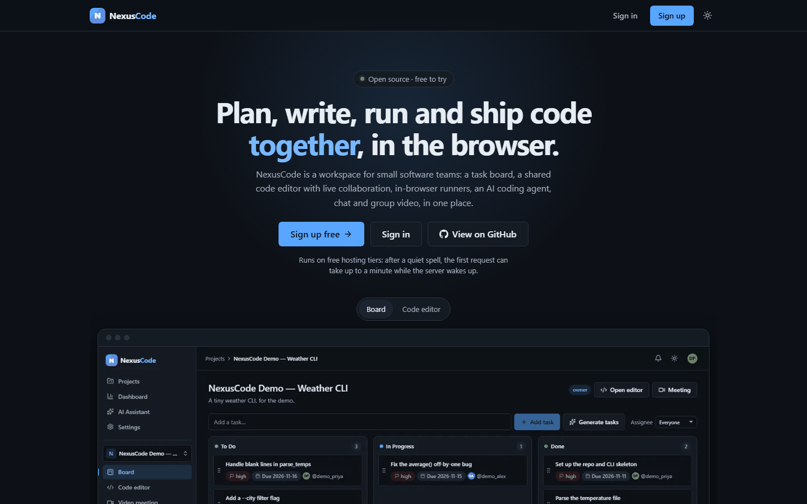
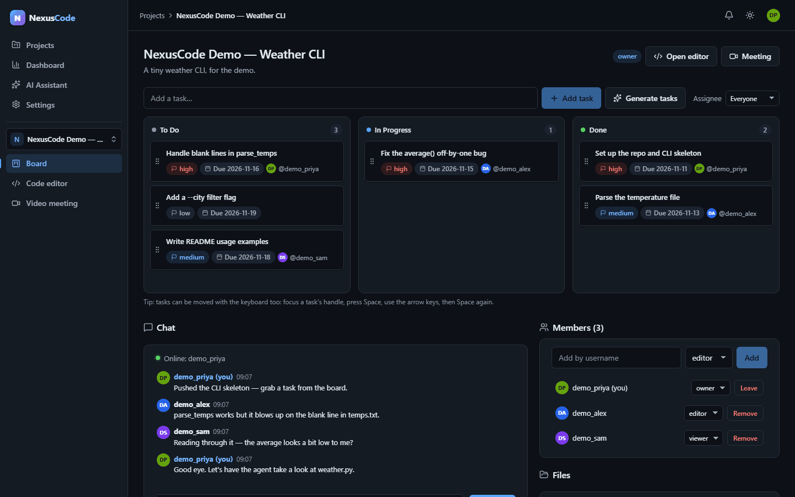
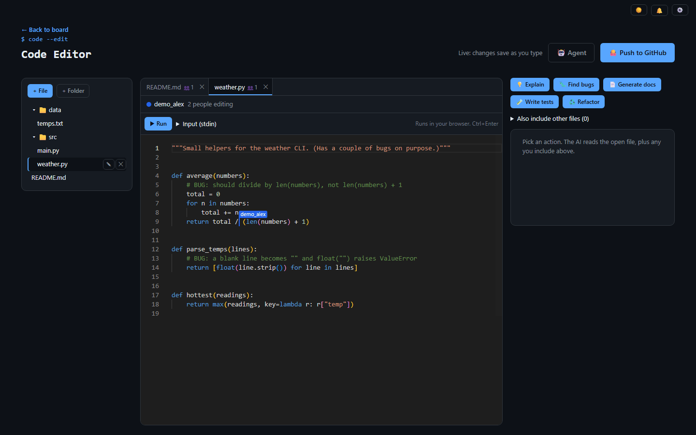
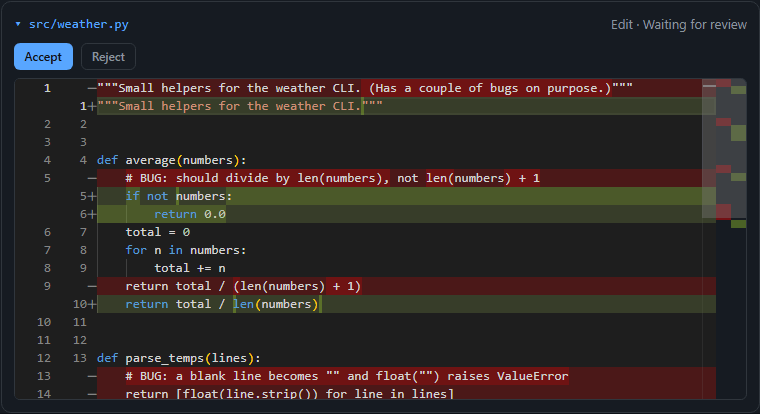
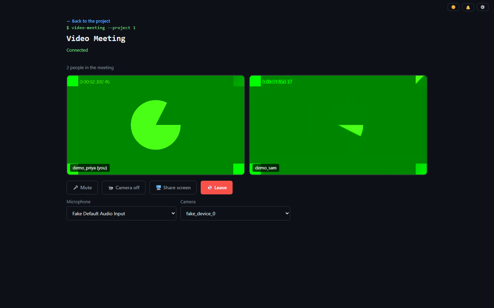
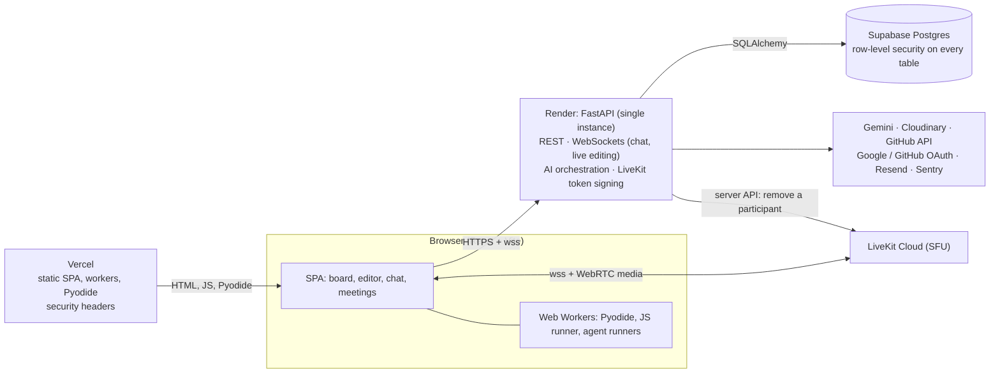

# NexusCode

**A workspace for small software teams: plan on a Kanban board, write code together in a shared editor, run it in the browser, get help from an AI coding agent, and talk over chat and group video.**

- **Live app:** [nexus-code-chi.vercel.app](https://nexus-code-chi.vercel.app)
- **Backend health:** [nexuscode-backend-wbt4.onrender.com/health](https://nexuscode-backend-wbt4.onrender.com/health) · API docs at [`/docs`](https://nexuscode-backend-wbt4.onrender.com/docs)

> Both services run on free hosting tiers. After a quiet spell, the first request can take up to about a minute while the backend wakes up.



---

## Features

| | Feature | What it does |
|---|---|---|
| 🗂️ | **Kanban board with roles** | Drag tasks across To Do / In Progress / Done (mouse or keyboard), with assignees, priorities and due dates. Projects are shared as **owner**, **editor** or **viewer**; the role is checked on every API route and WebSocket, and Postgres row-level security is on for every table. |
| 🧑‍💻 | **Multi-file code editor** | Monaco (the editor inside VS Code) with a file tree, folders, tabs and language detection from the file extension. |
| 🤝 | **Real-time collaborative editing** | Edit the same file together with [Yjs](https://yjs.dev): each person's cursor and name, who is here, and edits made offline that merge when you reconnect. Documents are saved, so they survive restarts. |
| 🤖 | **AI coding agent** | Give it a goal and it reads and writes files and runs Python or JavaScript in your browser to check its work. Every change waits for you to **Accept** or **Reject** as a diff. At most 8 steps per run, its code runs with no network, and there is a daily quota (2 runs per user, 2 in total). |
| ✨ | **Streaming AI assistant** | Generate code, explain it, find bugs, write tests and docs, refactor, and suggest tasks for the board, with answers streamed as they are written (Google Gemini). |
| ▶️ | **In-browser runners** | Python (Pyodide, self-hosted), JavaScript (a sandboxed Web Worker) and a live HTML/CSS/JS preview (a sandboxed iframe). No user code ever runs on the server. |
| 🐙 | **GitHub push** | Connect GitHub once, then push every file in the project to a new or existing repository as a single commit. |
| 🔐 | **Sign in your way** | Username and password, **Google** or **GitHub**. Add an email to verify it and to reset a forgotten password; sign out every other device from Settings. |
| 📹 | **Group video meetings** | One [LiveKit](https://livekit.io) room per project: camera, microphone, screen share, device choice, speaking highlight. Any member can join. |
| 📰 | **Activity feed and notifications** | See what changed in a project, and get notified when you are added, assigned a task or given a new role. |
| 💬 | **Project chat** | Per-project chat over WebSockets, with history and who is online. |
| 📂 | **Files, dashboards** | Upload project files (Cloudinary), a personal analytics dashboard, and an admin dashboard for admin accounts. |

<table>
  <tr>
    <td></td>
    <td></td>
  </tr>
  <tr>
    <td></td>
    <td></td>
  </tr>
</table>

More in [`docs/screenshots/`](docs/screenshots/), which also says how each one was made. They show the seeded demo project, and the meeting uses Chromium's fake camera.

---

## Architecture



- **Code runs in the browser, not on the server.** The server never executes user code.
- **Video goes straight to LiveKit.** The backend only signs a 1-hour token for the project's room; audio, video and room membership live on LiveKit.
- **Live editing and chat** keep their rooms in the backend's memory, so it runs as one instance.

More detail: [`docs/ARCHITECTURE-NOTES.md`](docs/ARCHITECTURE-NOTES.md).

---

## Tech stack

| Layer | Technology |
|---|---|
| Frontend | React 19, Vite 8, React Router 7, Monaco (`@monaco-editor/react`), `@hello-pangea/dnd`, Recharts, plain CSS with light and dark themes |
| Real-time | Yjs, `y-monaco`, `y-websocket` (browser); `pycrdt` (server); FastAPI WebSockets |
| Code running | Pyodide (self-hosted), Web Workers, sandboxed iframe |
| Video | LiveKit Cloud, `livekit-client`, `@livekit/components-react`, `livekit-api` |
| Backend | Python 3.12, FastAPI, SQLAlchemy 2, Alembic, Pydantic Settings, PyJWT, pwdlib (bcrypt), `cryptography` (Fernet), slowapi |
| AI | Google Gemini via `google-genai`: `gemini-2.5-flash` (assistant), `gemini-3.5-flash-lite` (agent) |
| Services | Cloudinary (files), Resend (email), GitHub OAuth + REST API, Google OAuth, Sentry (errors) |
| Data and hosting | Supabase Postgres, Render (Docker), Vercel |
| CI | GitHub Actions: ruff + pytest (Postgres 16), eslint + Vitest + vite build + `npm audit` |

---

## Security

Only what is implemented in this repository:

- **OAuth with PKCE and signed `state`** for Google and GitHub sign-in; the GitHub repo connection also checks `state`.
- **Session invalidation with `token_version`.** Every login token carries it, and each request checks it. Changing or resetting a password, or "sign out other devices", raises it, which ends every other session.
- **Passwords hashed with bcrypt** (pwdlib). Password-reset and email-verification tokens are single-use and stored only as hashes.
- **Role checks on the server:** `require_project_role` (viewer < editor < owner) on project routes and WebSocket connections; non-members get a 404. A role change reaches open live-editing connections at once.
- **Row-level security** is enabled on every public table in Postgres.
- **Rate limiting** (slowapi) on login, sign-up, password reset, OAuth, AI, agent steps, WebSocket tickets and meeting tokens.
- **Single-use WebSocket tickets** (30 seconds), so the login token never goes in a URL.
- **Security headers:** the API sends `X-Content-Type-Options`, `X-Frame-Options: DENY`, `Referrer-Policy`, and HSTS over HTTPS. Vercel sends the same, plus a `Permissions-Policy` that allows the camera, microphone and screen capture for this site only.
- **CSP for the AI agent's workers,** so its code can't load scripts or reach the network through `import()`. The agent's runners also switch off `fetch`, XHR and sockets.
- **GitHub tokens encrypted at rest** with Fernet (`MultiFernet`, so keys can be rotated).
- **Secrets stay on the server:** the LiveKit API secret only signs tokens on the backend; the browser gets the public `wss://` URL.
- **Agent prompt hygiene:** file contents and program output reach the model fenced with a random per-run marker, and the server checks every tool call before the browser runs it.

---

## Local setup

### Prerequisites
- Python 3.12+ and Node.js 24 (what CI uses)
- PostgreSQL (or use SQLite for the tests only)
- On Windows, the backend's `pycrdt` extension may be blocked by Smart App Control; run the backend in WSL or Docker if so (see below)

### Backend

```bash
cd backend
python -m venv venv
source venv/bin/activate          # Windows: venv\Scripts\activate
pip install -r requirements.txt
cp .env.example .env              # then fill it in
python scripts/migrate.py         # create/upgrade the schema (Alembic)
uvicorn app.main:app --reload
```

API docs: `http://127.0.0.1:8000/docs`. Every variable is described in [`backend/.env.example`](backend/.env.example):

| Variables | Needed for |
|---|---|
| `JWT_SECRET`, `FRONTEND_URL`, `GITHUB_TOKEN_ENC_KEY` | **Required.** The server refuses to start without them. |
| `DATABASE_URL`, or `DB_HOST` / `DB_PORT` / `DB_NAME` / `DB_USER` / `DB_PASSWORD` / `DB_SSLMODE` | **Required:** the database. |
| `GEMINI_API_KEY` (and optionally `AGENT_GEMINI_API_KEY`) | AI assistant and agent. Optional: without a key the app still starts, and every AI route answers 503 "AI is not configured", which the UI shows. `AGENT_GEMINI_API_KEY` on its own turns on just the agent. |
| `CLOUDINARY_*` | File uploads. |
| `GITHUB_CLIENT_ID`, `GITHUB_CLIENT_SECRET`, `GITHUB_REDIRECT_URI` | Connect GitHub and push. |
| `GOOGLE_CLIENT_ID`, `GOOGLE_CLIENT_SECRET`, `GOOGLE_REDIRECT_URI` | Sign in with Google (off until all three are set). |
| `GITHUB_LOGIN_CLIENT_ID`, `GITHUB_LOGIN_CLIENT_SECRET`, `GITHUB_LOGIN_REDIRECT_URI` | Sign in with GitHub (a separate OAuth app from repo access). |
| `RESEND_API_KEY`, `MAIL_FROM_EMAIL`, `MAIL_FROM_NAME` | Email verification and password reset. |
| `LIVEKIT_URL`, `LIVEKIT_API_KEY`, `LIVEKIT_API_SECRET` | Video meetings (the endpoint answers 503 until all three are set). |
| `LOG_LEVEL`, `LOG_FORMAT`, `SENTRY_*` | Logging and error tracking (optional). |

Optional features (AI, email, Google and GitHub sign-in, video) stay off until their variables are set: the app still starts, the login page only offers what the server has configured, and the routes of a feature that is off answer a clear 503 that the UI shows.

**OAuth callback URLs** to register with the providers (local / production):
- Google: `http://localhost:8000/auth/google/callback`, `https://nexuscode-backend-wbt4.onrender.com/auth/google/callback`
- GitHub sign-in: `http://localhost:8000/auth/github/login/callback`, `https://nexuscode-backend-wbt4.onrender.com/auth/github/login/callback` (one OAuth app per environment, since a GitHub OAuth app has a single callback)

**Email without a domain:** with `MAIL_FROM_EMAIL=onboarding@resend.dev`, Resend only delivers to your own Resend account's address; the app says so. Verify a domain at Resend to email everyone.

**Docker:**

```bash
cd backend
docker build -t nexuscode-backend .
docker run -p 8000:8000 --env-file .env -e DB_HOST=host.docker.internal nexuscode-backend
```

`DB_HOST=host.docker.internal` reaches a Postgres running on your own machine; leave it out when `.env` points at a remote database. The container runs `scripts/migrate.py` before starting, as Render does.

**WSL (if Windows blocks `pycrdt`):**

```bash
wsl -d Ubuntu -- bash -lc "cd /mnt/c/path/to/NexusCode/backend && python3 -m venv ~/nexus-venv && ~/nexus-venv/bin/pip install -r requirements-dev.txt && ~/nexus-venv/bin/python -m uvicorn app.main:app --host 0.0.0.0 --port 8000"
```

### Frontend

```bash
cd frontend
npm install
cp .env.example .env   # then fill it in
npm run dev            # http://localhost:5173
```

| Variable ([`frontend/.env.example`](frontend/.env.example)) | Needed for |
|---|---|
| `VITE_API_URL` | **Required:** the backend URL, e.g. `http://127.0.0.1:8000`. |
| `VITE_LIVEKIT_URL` | Video meetings: the same public `wss://` URL as `LIVEKIT_URL`. Never put the LiveKit key or secret here. |
| `VITE_SENTRY_DSN`, `VITE_SENTRY_ENVIRONMENT` | Error tracking in the browser (optional). |

### Demo data

[`backend/scripts/seed_demo.py`](backend/scripts/seed_demo.py) creates a demo project (three users as owner / editor / viewer, tasks, chat, activity and a small Python project with two planted bugs for the agent). It refuses to run unless `DEMO_SEED=1`, refuses production-looking database hosts, prints its plan first, and `--remove` deletes only what it created:

```bash
cd backend
python scripts/seed_demo.py --plan          # show what it would do
DEMO_SEED=1 python scripts/seed_demo.py     # local or throwaway database only
DEMO_SEED=1 python scripts/seed_demo.py --remove
```

A 5-7 minute walkthrough using it: [`docs/DEMO-SCRIPT.md`](docs/DEMO-SCRIPT.md).

---

## Testing

```bash
cd backend
pip install -r requirements-dev.txt
ruff check .
pytest                                                    # SQLite (temporary file)
TEST_DATABASE_URL="postgresql://postgres@127.0.0.1:5432/postgres?sslmode=disable" pytest   # a THROWAWAY local Postgres: it is wiped

cd frontend
npx vitest run
npx eslint .
npx vite build
```

Current results (run on this branch):

| Suite | Result |
|---|---|
| Backend, SQLite | 996 passed |
| Backend, Postgres (throwaway) | 996 passed |
| Frontend (Vitest) | 712 passed (49 files) |
| ruff · eslint · vite build | clean |

CI runs the same on every push and pull request (backend against Postgres 16).

---

## Deployment

Backend on Render (Docker; migrations run on start), database on Supabase, frontend on Vercel (SPA rewrite and headers in [`frontend/vercel.json`](frontend/vercel.json)). The step-by-step runbook (backup, read-only preflight, CI, merge, checks, rollback) is [`docs/DEPLOY.md`](docs/DEPLOY.md); `backend/scripts/preflight.py` checks the configuration, the database's migration head and RLS without printing any value.

---

## In more detail

### Running code

Run (or **Ctrl+Enter**) picks a runner from the file extension and uses what's in the editor, unsaved changes included. Nothing is sent to a server, so viewers can run code too.

| File | Runs as | Runs in |
|---|---|---|
| `.py` | Python via [Pyodide](https://pyodide.org) | Web Worker |
| `.js`, `.mjs`, `.cjs` | JavaScript | Web Worker with an opaque origin |
| `.html`, `.htm`, `.css` | Live preview of the project's page | Sandboxed iframe (`allow-scripts` only) |

- **Limits:** 10 seconds and 100,000 characters of output per Python or JavaScript run, enforced from the page.
- **Python:** the standard library only (no `micropip`). The project's other `.py` files are available, so `import` between them works, and `input()` reads the Input box.
- **JavaScript:** one file at a time (no imports of other project files).
- **Size:** Pyodide is downloaded (about 6.4 MB gzipped) only the first time someone runs Python, then cached.

### AI agent

Editors and owners open **🤖 Agent** in the editor and give it a goal. For each step the server streams one Gemini reply; the browser runs the tools (`list_files`, `read_file`, `write_file`, `run_file`, `add_task`) on a working copy and sends the results back. Every file change is a diff to **Accept** or **Reject** (and **Undo**), and nothing is saved until you accept it.

| Limit | Value |
|---|---|
| Model | `gemini-3.5-flash-lite` (its own key can be set with `AGENT_GEMINI_API_KEY`) |
| Steps | At most 8 Gemini calls per run |
| Per run | 250,000 tokens and 15 minutes |
| Daily quota | 2 runs per user and 2 in total per UTC day (`USER_DAILY_RUNS`, `TOTAL_DAILY_RUNS` in `backend/app/services/agent.py`) |
| Network | None: fetch, XHR, sockets and nested workers are switched off, plus the CSP above |

### Live collaborative editing

Each code file is a Yjs document, synced over `/ws/code-files/{id}` with a fresh single-use ticket per (re)connect. The server keeps its own copy (`pycrdt`), checks each change before applying it, and saves both the Yjs state and the plain text (2 seconds after the last change, when the last person leaves, and on shutdown). Limits: 1,000,000 characters per file, 10 connections per user and 50 per project.

### Video meetings

Clicking **Join** asks `POST /projects/{id}/meeting/token` for a LiveKit token (1 hour, this project's room only, identity = user id), then connects straight to LiveKit. Leave, moving to another page and closing the tab all end the call and turn the camera off. Removing a member or deleting an account also removes them from a call in progress.

---

## Known limitations

- **Free-tier cold starts:** the backend sleeps when idle; the first request afterwards can take up to about a minute.
- **Single instance:** rate-limit counters, chat rooms and live-editing rooms live in the backend's memory, which is correct for one instance (as on Render's free tier). Running several would need a shared store such as Redis.
- **Gemini free-tier quota:** the AI features share a small daily allowance, and the agent is limited to 2 runs a day.
- **In-browser running:** Python has the standard library only, JavaScript runs one file at a time, and other languages can't run.
- **Email:** without a verified domain at Resend, email only reaches the Resend account owner's address.
- **Video** needs a LiveKit project; without its settings the meeting page says video isn't configured.

---

## License

[MIT](LICENSE). Built by **Govind Turkar** as a final-year college project.
